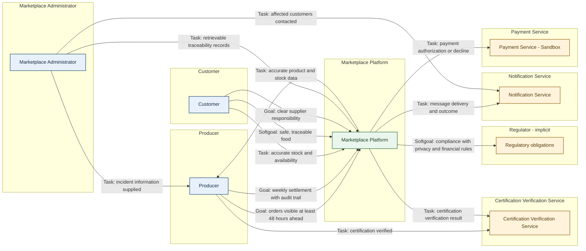

# Strategic Dependency (SD) Model — BRFN Digital Marketplace

This model summarizes the strategic dependencies between the Bristol Regional Food Network (BRFN) marketplace stakeholders. Each labeled link reads **depender → dependee**: the depender relies on the dependee to provide the stated dependum. Dependency categories are marked **Task**, **Goal**, or **Softgoal**.

## Dependency catalogue

| Depender | Dependee | Dependum | Type |
|---|---|---|---|
| Producer | Certification Verification Service | Certification verified | Task |
| Producer | Marketplace Platform | Orders visible at least 48 hours ahead | Goal |
| Producer | Marketplace Platform | Weekly settlement with audit trail | Goal |
| Customer | Marketplace Platform | Accurate stock and availability information | Task |
| Customer | Marketplace Platform | Safe, traceable food | Softgoal |
| Customer | Marketplace Platform | Clear per-supplier responsibility | Goal |
| Marketplace Platform | Producer | Accurate product and stock data | Task |
| Marketplace Platform | Payment Service | Payment authorized or declined | Task |
| Marketplace Platform | Notification Service | Messages delivered with outcome | Task |
| Marketplace Platform | Certification Verification Service | Verification result | Task |
| Marketplace Administrator | Marketplace Platform | Traceability records retrievable | Task |
| Marketplace Administrator | Notification Service | Affected customers contacted | Task |
| Marketplace Administrator | Producer | Incident information supplied | Task |
| Marketplace Platform | Regulator (implicit) | Privacy and financial-services compliance | Softgoal |

**Legend:** A **Task** dependency relies on an activity or result being delivered; a **Goal** dependency relies on an outcome; a **Softgoal** dependency relies on a quality or constraint whose satisfaction is qualitative.
