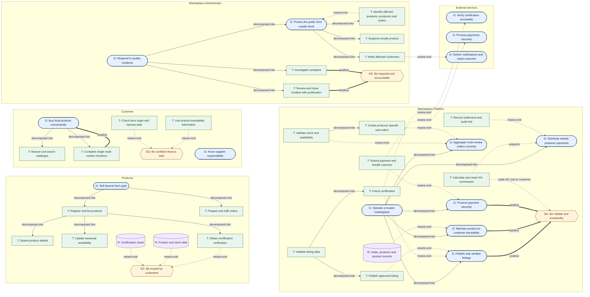

# Strategic Rationale (SR) Model — BRFN Digital Marketplace

This model explains how each actor's goals are supported by tasks and resources. **G** = hard goal; **SG** = softgoal; **T** = task; **R** = resource. Solid arrows indicate **decomposition** (a goal/task is broken into sub-elements); dashed arrows indicate **means–end** (a task/resource is a way to achieve a goal); bold arrows indicate **contribution** (positive or negative impact on a softgoal). Cross-actor dependencies are detailed in the [Strategic Dependency model](../strategic-dependency/strategic-dependency.md).

## Rationale highlights

- **Producer:** Listing, keeping availability current, and fulfilling orders support selling beyond the farm gate; verified claims and reliable product data support customer trust.
- **Customer:** Catalogue search and one multi-vendor checkout support convenient local purchasing. Origin, harvest, and traceability information support confidence in food safety.
- **Marketplace Platform:** Verification, order aggregation, secure payment, weekly settlement, and traceability jointly support a trusted marketplace. The 5% commission supports the revenue model, with a potential affordability trade-off to monitor.
- **Marketplace Administrator:** Investigation, product suspension, customer contact, and documented closure support incident response and public protection while reinforcing accountability.
- **External services:** Certification, payment, and notification services provide capabilities used by the platform and administrator; their detailed dependencies appear in the SD model.
